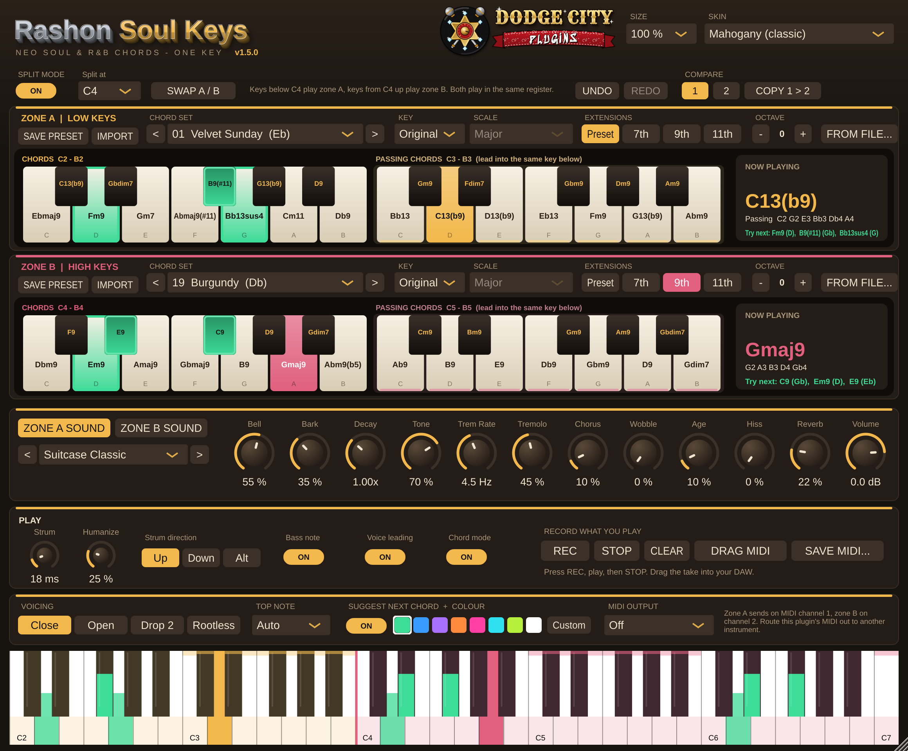

# Rashon Soul Keys

A VST3 instrument by Dodge City Plugins: play lush neo soul and R&B chords with one key.
One octave (C3 - B3) plays the chords of a chord set; the next octave (C4 - B4) plays passing chords
that lead into the chord on the same key below. Includes 50 chord sets, a 7th / 9th / 11th extensions switch, 6 electric piano and
4 tape piano sounds, strum, humanize, voice leading, and chord pulling from MIDI and audio files.

Version 1.3.0 adds MIDI output, voicing styles and top-note control, next-chord suggestions, undo/redo and compare.
Version 1.2.0 added a MIDI recorder with drag-to-DAW and your own presets (save and import .soulkeys files).
Version 1.1.0 added Split Mode (two chord sets and two sounds across the keyboard), key and scale
selection, and 15 skins.

See `docs/INSTALL.txt` for how to install and play. Windows builds come from GitHub Actions.
