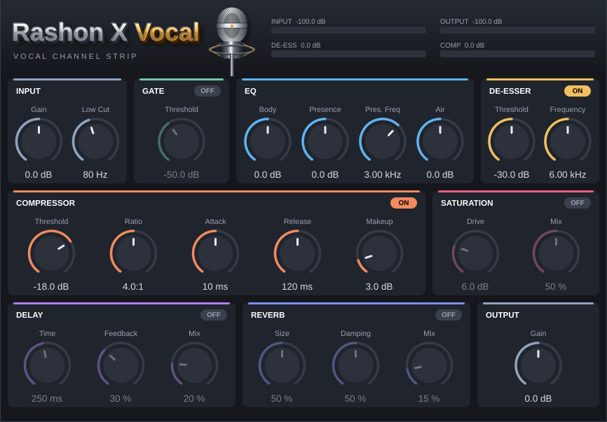

# Rashon X Vocal

An all-in-one vocal channel strip plugin (VST3 for Windows), built with [JUCE](https://juce.com).



## Signal chain

| # | Module | Controls | What it's for |
|---|--------|----------|---------------|
| 1 | Input | Gain, Low Cut (20–400 Hz) | Set level, remove rumble and mic thumps |
| 2 | Gate | Threshold | Silence room noise between phrases |
| 3 | EQ | Body (200 Hz), Presence (+ frequency), Air (10 kHz) | Shape the tone |
| 4 | De-esser | Threshold, Frequency | Tame harsh "s" and "sh" sounds |
| 5 | Compressor | Threshold, Ratio, Attack, Release, Makeup | Even out the level |
| 6 | Saturation | Drive, Mix | Add warmth and grit |
| 7 | Delay | Time, Feedback, Mix | Echo |
| 8 | Reverb | Size, Damping, Mix | Space |
| 9 | Output | Gain | Final level |

Meters at the top show input level, de-esser and compressor gain reduction, and output level.

## Getting the plugin (no compiler needed)

Every push to GitHub builds the plugin automatically:

1. Open the repo's **Actions** tab and click the latest **Build plugin** run.
2. Download **RashonXVocal-Windows** under *Artifacts* and unzip it.
3. Follow `INSTALL.txt` (copy `Rashon X Vocal.vst3` to `C:\Program Files\Common Files\VST3\`).

## Building yourself

Needs CMake 3.22+ and Visual Studio 2022 or newer (with "Desktop development with C++"). JUCE is downloaded automatically.

```bash
cmake -B build
cmake --build build --config Release
```

The plugin ends up in `build/VocalStrip_artefacts/Release/VST3/` (as `Rashon X Vocal.vst3`).

Run the audio smoke test (Linux or macOS):

```bash
cmake -B build -DVOCALSTRIP_BUILD_TESTS=ON
cmake --build build --target VocalStripSmokeTest && ./build/VocalStripSmokeTest
```

## Code layout

- `Source/PluginProcessor.*` - all audio processing and parameters
- `Source/PluginEditor.*` - the plugin window
- `Tests/SmokeTest.cpp` - runs audio through every module and checks the output

## License

JUCE 8+ is dual-licensed (AGPLv3 or a commercial JUCE license). Free use is fine for personal projects;
if you plan to sell or distribute the plugin closed-source, check JUCE's licensing terms first.
